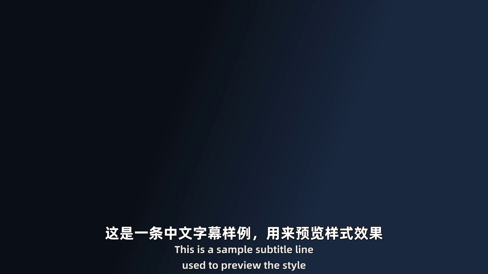

# YouTube-BBQ

> 一个 skill（`youtube-subtitle-translate`）：给一个 YouTube 链接，自动完成 **下载 → 字幕 → 翻译 → 打轴 → 压制**，输出翻译好的 ASS 字幕文件，以及压制好硬字幕的视频。

油管 = YouTube，烤制 = 把外语视频"烤"成带中文字幕的成品。默认全自动：开工前报一次清单，用户确认后一口气跑完。



## 它能做什么

- 下载 YouTube 视频（可选高质量档位 / 片源编码）与**网站自带的字幕**（人工轨或自动轨）；
- 把字幕**翻译成中文并重新排版打轴**——按语义分句、宽度最优 10 字（上限 16 字）、双语上下两行；
- 输出 **ASS 字幕文件**（可另加 VTT / SRT），并按需**压制硬字幕**（带 libass 的 ffmpeg，硬件编码优先 AV1 → HEVC → H.264）或输出 **MKV 软字幕**（随片内嵌字体）；
- 人工简体中文轨可**直接使用**、不翻译；中英双轨可**原生直出**双语。

## 工作流程

```
下载视频 + 字幕  ──┬─► 解析字幕（元素表 + 纯词流）
                   │
                   └─► AI 只写文本（分句 / 翻译 / 切行）
                              │
                       机械绑定编号（脚本，不手写）
                              │
                    合并短句 → 打轴输出 → 全量机检报告
                              │
                        压制硬字幕 / 软字幕
```

设计要点：**AI 只负责写文本，编号与时间轴全部由脚本机械绑定**；每翻完一块立刻跑机检报表、当场修正，跨块保持术语一致，最后 AI 通读终校并出报告。

## 目录结构

```
SKILL.md                  技能定义与主流程（自动字幕 / 人工字幕两条主线）
references/
  ├─ 设计规则.md           全部业务规则（下载 / 自动 / 人工 / 格式 / 压制 / 执行要求）
  └─ 脚本说明.md           每个脚本的用法、输入输出与重建要点
scripts/
  ├─ download.py          下载视频与字幕、选轨、校验
  ├─ parse_json3.py       解析自动字幕 → 元素表 + 纯词流
  ├─ parse_manual.py      解析人工字幕
  ├─ filler_scan.py       语气词机械记账
  ├─ bind_ids.py          文本 ↔ 编号机械绑定（带报表）
  ├─ merge_shorts.py      整句过短的"保下限"合并
  ├─ build_auto.py        自动字幕：打轴 + 输出 + 全量机检
  ├─ build_manual.py      人工字幕：打轴 + 输出
  ├─ burn.py              压制硬字幕 / 软字幕（ffmpeg）
  ├─ sub_style.py         ASS 样式与字幕写入
  ├─ preview_style.py     样式预览帧渲染
  ├─ report_progress.py   下载/压制进度报点器
  ├─ setup_fonts.py       字体准备（生成本技能用的字体副本）
  └─ cookies/             浏览器 cookie 提取（CDP）
assets/
  └─ style-preview-*.png  默认样式示意图（双语 / 单中文 / 单外语）
secrets/                 使用者私密目录（随仓库为空）
```

## 环境要求

| 依赖 | 说明 |
|---|---|
| Python 3 | 运行 `scripts/` 下脚本 |
| `yt-dlp`、`yt-dlp-ejs`、`curl-cffi` | 下载与解析（`pip install yt-dlp yt-dlp-ejs curl-cffi`） |
| `node` | `yt-dlp-ejs` 的 JS 运行时 |
| `ffmpeg` | **必须带 libass**，否则字幕烧不进画面 |
| 代理 | 访问 YouTube 需要；技能会自动探测常见端口，也可显式指定 |

## 安装

把整个仓库放进 skill 目录之一即可被自动发现：

| 位置 | 作用范围 |
|---|---|
| `~/.agents/skills/`（Windows：`C:\Users\<你>\.agents\skills\`） | 所有项目（推荐） |
| `<项目>/.agents/skills/` | 仅该项目 |
| `~/.zcode/skills/` 或 `<项目>/.zcode/skills/` | 同名时优先，用于覆盖 |

例如：

```bash
git clone https://github.com/rea1s/YouTube-BBQ.git ~/.agents/skills/youtube-subtitle-translate
```

放好后，提到"油管/YouTube 下载、字幕翻译、压制字幕"等就会自动触发本 skill。

## 首次使用

- **字体需要自己生成**：字幕要用的两套字体（中文用阿里巴巴普惠体 3.0 95 ExtraBold、原文/英文用 Alibaba Sans Bold）**不随本仓库提供**（属第三方字体，授权与体积原因）。首次使用时运行：

  ```bash
  python scripts/setup_fonts.py
  ```

  脚本会从本机字体目录或阿里官方直链获取原版字体，生成改过族名的副本到 `assets/fonts/`。**缺字体会静默回退成别的字体，务必先生成**。
  （`assets/style-preview-*.png` 是预渲染的样式示意图，仓库已提供；如需在**你自己的视频**上重新生成预览，用 `scripts/preview_style.py`。）
- **`secrets/` 里只有说明文件，这是正常的**：cookie 属于使用者本人，不随仓库分发。技能在需要时会引导你现场获取（会先让你关闭浏览器再用 CDP 提取），也可以自行把 Netscape 格式的 cookie 放入该目录。

## 使用

给一个 YouTube 链接即可。默认全自动；也可以在开头或用清单确认时逐条指定：

```text
选项            默认                            可选
是否只下载字幕   关                              不下载视频，只下载并处理字幕
视频质量         1080p60fps                      720p60 / 2160p / best 等
片源编码         VP9（默认走 HLS 分片下载）        AV1 / H.264
代理             外部代理（自动探测）             内部代理 / 指定端口
字幕形式         双语（中文在上、原文在下）       中文在下原文在上 / 仅中文 / 仅原文
字幕样式         默认款（见预览图）              自行定制 / 提供示例 .ass
输出格式         ASS                             另加 VTT / SRT
字幕压制         压制硬字幕                       不压制 / 压制软字幕（MKV 内嵌字体）
压制时机         直接压制                        先出字幕，确认改完后再压制
压制编码         自动（硬件优先 AV1→HEVC→H.264）  AV1 / HEVC / H.264 / 只用 CPU H.264
```

> 内置字体只覆盖**中文 + 英文（拉丁/西里尔）**；原文若为日文/韩文等会回退系统字体，样式可能不一致。

## 输出物

`<名称>.mp4`（原片）+ `<名称>.hardsub.mp4`（默认输出）+ `<名称>.ass` + `<名称>.机检报告.md` + `<名称>.报告.md`；批量时最外层另有汇总报告。

## 说明与限制

- **只针对 YouTube**；字幕取自网站自带（人工或自动），**不做本地语音识别**。
- 需要自备可用的代理环境。
- 本仓库**不包含任何字体文件**（第三方字体，见上文生成方式）、**不包含任何人的 cookie、账号或本机路径信息**。
- `references/` 与 `SKILL.md` 只描述"现在是什么样"，不含开发过程记录。

## 许可

本项目采用 [MIT License](LICENSE)。

注意：技能运行时会（由使用者自行）获取的**阿里巴巴普惠体 / Alibaba Sans 字体**为第三方作品，遵循其各自的授权条款，不在本仓库的 MIT 授权范围内。
